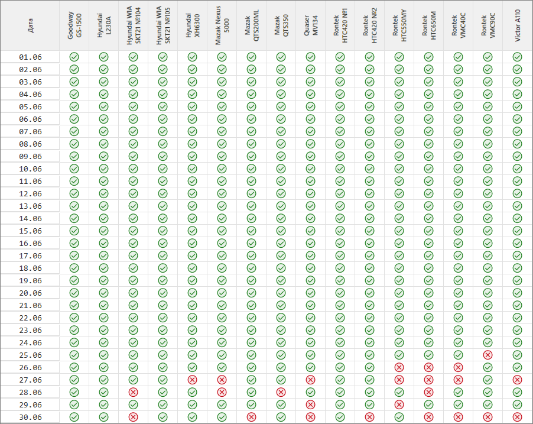

# Регламент заполнения, контроля и анализа данных в ЭЖ

1\. Назначение и область применения

Настоящий документ определяет требования к заполнению, контролю и анализу данных в Электронном журнале.

Цель – обеспечение единого порядка ведения ЭЖ на всех этапах: от первичного ввода данных оператором до финального анализа СГТ.  
Соблюдение этих требований гарантирует:

- достоверность и полноту данных для расчёта К1 операторов;
- возможность автоматического анализа данных ИИ-ассистентом;
- прозрачность процесса проверки на всех уровнях;
- обоснованность решений об корректировке нормативов и технологии изготовления.

Область применения – все операции, выполняемые операторами, мастерами, аналитическим отделом СГТ.

2\. Роли и ответственность

| **Роль** | **Ответственность** |
|----|----|
| **Оператор** | Первичный ввод данных: времена, детали, простои, комментарии. |
| **Мастер** | Верификация данных оператора, выбор причин и объяснение отклонений. |
| **СГТ 1** | Верификация данных оператора и мастера, принятие решение об эскалации. |
| **СГТ 2** | Разбор эскалированных дней, финальное решение по проблемным записям. |

В перспективе – замена ручной верификации на этапе **СГТ 1** на автоматический анализ данных.

3\. Заполнение оператором

| Инструкция оператора по работе с ЭЖ в приложенном файле: |  |
|----|----|

В дополнение к инструкции стоит добавить, что данные, указанные оператором – основа. Сначала их проверяет мастер – он видит первичную картину, выбирает причины отклонений и дополняет комментариями. СГТ уже после этого сопоставляет факты (времена, показатели эффективности, простои), комментарий оператора как участника процесса и отметки мастера как официальную причину. На основе всего этого делается вывод о том стоит ли вносить корректировки в техпроцесс, исключать записи из расчётов и т.д.  
Что важно понимать для корректного результата:

**Комментарий оператора** – единственное свидетельство того, что происходило на самом деле. Мастер видит итоговые цифры, но он не был у станка всё время. Если нормально не описать нештатную ситуация, никто не сможет её объяснить – цифры показывают только факт отклонения, а не причину. Конкретные детали (какой инструмент, почему дольше, что изменилось) – это то, что позволяет качественно объяснить отклонения. Если комментарий оператора содержит указания на проблемы с нормативами или технологией – это провоцирует проверку СГТ автоматически, так что не следует пренебрегать этой возможностью. Указание оператора на некорректный норматив является поводом для его рассмотрения, но не гарантией его корректировки, особенно если нет корректного обоснования, в т.ч. от мастера.

**Мастер выбирает причину отклонения из списка и, при необходимости, уточняет комментарием** – это официальная позиция. Если мастер выбрал, например, «Разовое изменение времени из-за проблем с инструментом» и написал конкретный комментарий – это можно сопоставить это с комментарием оператора и цифрами. Если всё сходится описана конкретная проблема – разовая проблема объяснена, запись может быть исключена из расчёта К1.

**Простои** – время простоев исключается из показателей наладки и изготовления. Как описано в инструкции – некоторые виды простоев никогда не учитываются, также на усмотрение СГТ любой простой может быть исключен из расчёта, но для этого нужен адекватный комментарий, описывающий причину.

**Машинное время > штучного норматива – проверяется всегда на не штучных партиях, даже при хорошем итоговом показателе изготовления.** Если мастер указал разовую причину («Разовое изменение...» или «Несоответствующие заготовки») с конкретным комментарием о станочном времени – разбор технологами не нужен, запись не учитывается в расчёте К1. Если оператор и/или мастер укажет, что норматив некорректен – он будет **рассмотрен** СГТ.

**«Освоение» в комментарии** объясняет низкий показатель наладки только если деталь действительно новая на этом станке. Проверяется история изготовления. Если деталь уже делалась – освоением это не является. Исключением является изменение технологии или КД. Мастер также должен выбрать соответствующую причину.

**Итог проверки** – это результат совместной работы: данные оператора **→** верификация мастера **→** анализ СГТ. Учитываются все три источника: фактические показатели, комментарии, отметки мастера. Если хотя бы один источник неполон – достоверность вывода снижается. Полнота и качество заполнения напрямую влияют на корректность анализа (в будущем автоматического) и, как следствие, на расчёт К1.

4\. Заполнение мастером

4.1. Общий процесс

- `Мастер открывает ``"Отчёты по журналу"``;`

- `Выбирает дату и открывает ``"Подробно"`` для каждого станка``;`

- `Просматривает записи оператора``;`

- `Для каждой записи с аномалиями:`

  - `Выбирает причину отклонения из выпадающего списка + при необходимости добавляет комментарий``;`

  - `Создает отчёт за смену``;`

  - `Повторяет для каждого станка.`

- `После проверки рядом названием станка появится отметка `` обозначающая наличие ``отчёта``.`

- `За каждый день все станки должны быть отмечены таким образом.`

4.2. Что проверяет мастер

При проверке записи оператора мастер оценивает данные по нескольким пунктам. Если что-то не в норме – система не даст завершить проверку, пока не будет указана причина.

- **Дата, смена, отработанное время** – табельная информация.  
  Этими данными владеет именно мастер.

- **Наладка / частичная наладка**:

> Показатель наладки должен быть в пределах 70–200%. Если ниже 70% или выше 200% – нужно указать причину. При отсутствии норматива при наличии М/Л – тоже.

- **Изготовление**: показатель должен быть в пределах 70–120%. Если вне диапазона или нет норматива при наличии М/Л – указать причину.

- **Простои**: если время простоев превышает 50% от общего времени записи – нужно дать комментарий.

- **Машинное время > штучного норматива**  
  Если машинное время превышает штучный норматив – это требует разбора. Штучный норматив включает и машинное время, и ручные операции: если машинное время уже больше всего норматива, на ручные операции времени не осталось. Проверяется всегда, даже при хорошем показателе изготовления.

4.3. Заполнение причин отклонений

Мастер выбирает причины отклонений из предопределённых списков для "Отклонения в наладке" и "Отклонения в изготовлении", списки для них различаются. Представленные в списках причины являются типовыми, часть из них должна сопровождаться конкретизирующими комментариями – в большинстве случаев не просто скопированным комментарием оператора, а действительным пояснением к выбранной причине.

***  
*Отклонения в наладке**

<table>
<colgroup>
<col style="width: 19%" />
<col style="width: 10%" />
<col style="width: 70%" />
</colgroup>
<thead>
<tr>
<th style="text-align: center;"><strong>Причина</strong></th>
<th style="text-align: center;"><strong>Требуется комментарий</strong></th>
<th style="text-align: center;"><strong>Примечание</strong></th>
</tr>
</thead>
<tbody>
<tr>
<td style="text-align: center;">Доработка</td>
<td style="text-align: center;"><strong>Да</strong></td>
<td>Доработкой является какая-либо операция, которая не планировалась выполнению и выполняется вследствие какой-либо ошибки. 
Пример 1: на детали забыли выполнить резьбовое отверстие – деталь запущена в работу для выполнения забытого резьбового отверстия. 
Пример 2: на ОТК выяснилось, что отверстие на детали изготовлено вне допуска – деталь запущена в работу для доработки отверстия.</td>
</tr>
<tr>
<td style="text-align: center;">Другое</td>
<td style="text-align: center;"><strong>Да</strong></td>
<td>Только если ни одна из доступных причин в списке не подходит. 
Требуется объяснение с детализацией.</td>
</tr>
<tr>
<td style="text-align: center;">Изготовление не по техпроцессу</td>
<td style="text-align: center;"><strong>Да</strong></td>
<td>Выбирается если не совпадает операция, количество установок или вид рабочего центра. В комментарий указать что именно не соответствует. 
Пример 1: деталь делается за три установки вместо двух. 
Пример 2: выполняется с токарно-фрезерная операция на плунжере, тогда как техпроцесс подразумевает раздельные токарную и фрезерную операции.</td>
</tr>
<tr>
<td style="text-align: center;">Изготовление типовой детали</td>
<td style="text-align: center;">Нет</td>
<td>Объясняет аномально высокий показатель наладки, если производилась наладка с аналогичной детали, тем что, инструмент и станок уже были частично подготовлены. 
Не может объяснять низкий показатель наладки.</td>
</tr>
<tr>
<td style="text-align: center;">Небрежное отношение к работе</td>
<td style="text-align: center;"><strong>Да</strong></td>
<td></td>
</tr>
<tr>
<td style="text-align: center;">Некорректное заполнение</td>
<td style="text-align: center;">Нет</td>
<td>Желательно отметить корректно, либо самостоятельно, либо поручить оператору. Дни с такими записями будут подвержены эскалации, конкретные записи могут быть исключены из расчёта К1 (на усмотрение сотрудника аналитического отдела).</td>
</tr>
<tr>
<td style="text-align: center;">Некорректные нормативы</td>
<td style="text-align: center;">Нет</td>
<td>Только если они действительно некорректные при правильном техпроцессе – совпадает рабочий центр и операция. Если деталь уже нормально выполнялась с этими нормативами на этом же оборудовании – норматив корректен. 
Если норматив с другого вида рабочего центра, либо с другой операции – это изготовление не по техпроцессу.</td>
</tr>
<tr>
<td style="text-align: center;">Неопытный оператор</td>
<td style="text-align: center;">Нет</td>
<td>Объясняет низкие показатели наладки и/или изготовления.</td>
</tr>
<tr>
<td style="text-align: center;">Освоение</td>
<td style="text-align: center;">Нет</td>
<td>Объясняет низкий показатель наладки и превышение частичной наладки только при отсутствии изготовления этой детали по этой технологии на этом виде оборудования.
Если деталь ранее не выполнялась на этом станке – это освоение. 
Если произошли существенные изменения КД и/или технологии, относящиеся к механической обработке – это освоение. 
Нужно указать, что именно изменилось. 
Если оператор безосновательно переписал УП, по которой ранее выпускались детали (без указания причины) – это не освоение. 
Изменения КД/технологии, не относящиеся к механической обработке (например, только требования к ЛКП или маркировке) – не основание для повторного освоения: сама обработка детали на станке не изменилась.</td>
</tr>
<tr>
<td style="text-align: center;">Особенности изготовления</td>
<td style="text-align: center;"><strong>Да</strong></td>
<td>Особенности, из-за которых <u>невозможно корректно учесть производительность</u>. 
Например: деталь выполняется по обеим установкам на двух паллетах одновременно. Плохое стружкообразование, остановки и пр. – другая категория.</td>
</tr>
<tr>
<td style="text-align: center;">Отсутствие нормативов</td>
<td style="text-align: center;">Нет</td>
<td>Только если они действительно отсутствуют при правильном техпроцессе – совпадает рабочий центр и операция. Для записей без заказа («Без М/Л») отсутствие норматива – норма, отдельного объяснения не требуется. 
Если деталь выполняется не по техпроцессу, то для этого есть своя причина в списке.</td>
</tr>
<tr>
<td style="text-align: center;">Работа ученика</td>
<td style="text-align: center;">Нет</td>
<td>Объясняет низкие показатели наладки и/или изготовления.</td>
</tr>
</tbody>
</table>

**Отклонения в изготовлении**

<table>
<colgroup>
<col style="width: 19%" />
<col style="width: 10%" />
<col style="width: 70%" />
</colgroup>
<thead>
<tr>
<th style="text-align: center;"><strong>Причина</strong></th>
<th style="text-align: center;"><strong>Требуется комментарий</strong></th>
<th style="text-align: center;"><strong>Примечание</strong></th>
</tr>
</thead>
<tbody>
<tr>
<td style="text-align: center;">Доработка</td>
<td style="text-align: center;"><strong>Да</strong></td>
<td>Доработкой является какая-либо операция, которая не планировалась выполнению и выполняется вследствие какой-либо ошибки. 
Пример 1: на детали забыли выполнить резьбовое отверстие – деталь запущена в работу для выполнения забытого резьбового отверстия. 
Пример 2: на ОТК выяснилось, что отверстие на детали изготовлено вне допуска – деталь запущена в работу для доработки отверстия.</td>
</tr>
<tr>
<td style="text-align: center;">Другое</td>
<td style="text-align: center;"><strong>Да</strong></td>
<td>Только если ни одна из доступных причин в списке не подходит. 
Требуется объяснение с детализацией.</td>
</tr>
<tr>
<td style="text-align: center;">Изготовление не по техпроцессу</td>
<td style="text-align: center;"><strong>Да</strong></td>
<td>Выбирается если не совпадает операция, количество установок или вид рабочего центра. В комментарий указать что именно не соответствует. 
Пример 1: деталь делается за три установки вместо двух. 
Пример 2: выполняется с токарно-фрезерная операция на плунжере, тогда как техпроцесс подразумевает раздельные токарную и фрезерную операции.</td>
</tr>
<tr>
<td style="text-align: center;">Небрежное отношение к работе</td>
<td style="text-align: center;"><strong>Да</strong></td>
<td></td>
</tr>
<tr>
<td style="text-align: center;">Некорректное заполнение</td>
<td style="text-align: center;">Не<strong>т</strong></td>
<td>Желательно отметить корректно, либо самостоятельно, либо поручить оператору. Дни с такими записями будут подвержены эскалации, конкретные записи могут быть исключены из расчёта К1 (на усмотрение сотрудника аналитического отдела).</td>
</tr>
<tr>
<td style="text-align: center;">Некорректные нормативы</td>
<td style="text-align: center;">Нет</td>
<td>Только если они действительно некорректные при правильном техпроцессе – совпадает рабочий центр и операция. Если деталь уже нормально выполнялась с этими нормативами на этом же оборудовании – норматив корректен. 
Если норматив с другого вида рабочего центра, либо с другой операции – это изготовление не по техпроцессу.</td>
</tr>
<tr>
<td style="text-align: center;">Неопытный оператор</td>
<td style="text-align: center;">Нет</td>
<td>Объясняет низкие показатели наладки и/или изготовления.</td>
</tr>
<tr>
<td style="text-align: center;">Несоответствующие заготовки</td>
<td style="text-align: center;"><strong>Да</strong></td>
<td>Фактические заготовки отличаются от указанных в техпроцессе – размерами или механическими свойствами. 
Пример 1: срабатывал отходы, заготовки разных диаметров.
Пример 2: перекаленные заготовки.</td>
</tr>
<tr>
<td style="text-align: center;">Особенности изготовления</td>
<td style="text-align: center;"><strong>Да</strong></td>
<td>Особенности, из-за которых <u>невозможно корректно учесть производительность</u>. 
Например: деталь выполняется по обеим установкам на двух паллетах одновременно. Плохое стружкообразование, остановки и пр. – другая категория.</td>
</tr>
<tr>
<td style="text-align: center;">Отсутствие нормативов</td>
<td style="text-align: center;">Нет</td>
<td>Только если они действительно отсутствуют при правильном техпроцессе – совпадает рабочий центр и операция. Для записей без заказа («Без М/Л») отсутствие норматива – норма, отдельного объяснения не требуется. 
Если деталь выполняется не по техпроцессу, то для этого есть своя причина в списке.</td>
</tr>
<tr>
<td style="text-align: center;">Работа ученика</td>
<td style="text-align: center;">Нет</td>
<td>Объясняет низкие показатели наладки и/или изготовления.</td>
</tr>
<tr>
<td style="text-align: center;">Разовое изменение из-за проблем с инструментом/оборудованием</td>
<td style="text-align: center;"><strong>Да</strong></td>
<td>Требуется конкретная причина, послужившая причиной отклонения. 
Пример 1: оператор использует менее производительное HSS сверло вместо твердосплавного. 
Пример 2: оператор использует сверло Ø30 и растачивает отверстие вместо использования сверла Ø40, т.к. оно занято.</td>
</tr>
<tr>
<td style="text-align: center;">Штучная /длительная работа</td>
<td style="text-align: center;">Нет</td>
<td>Объясняет аномальные значения выработки только при малой партии: 
<strong>м/в &lt; 3 мин и изготовлено ≤ 10 деталей</strong> или <strong>м/в ≥ 3 мин и изготовлено ≤ 5 деталей</strong>;</td>
</tr>
</tbody>
</table>

4.4. Комментарий мастера

Комментарий мастера состоит из нескольких частей и заполняется раздельно для категории проблемы:

- Причина – выбор из выпадающего списка (описаны выше);  
  Столбцы «Отклонения в наладке/изготовлении».
- Уточнение – текстовый комментарий, конкретизирующий причину.  
  Столбцы «Комментарий мастера (наладка/изготовление)».
- Произвольный комментарий на усмотрение мастера.  
  Столбец «Комментарий мастера».

4.5. Комментарий к простоям

Заполняется мастером для пояснения слишком долгих простоев.  
Должен быть релевантен `отмеченным простоям и не быть скопированным комментарием оператора`

4.6. Формирование отчёта

После проверки всех записей мастер заполняет отчёт за смену в котором, при необходимости указывает причину простоя оборудования, чрезмерно длительной частичной наладки и произвольный комментарий.

<u>Результатом работы мастера</u> является наличие суточных отчётов по всем станкам за все даты и корректные, релевантные объяснения отклонений при работе/простое каждой единицы оборудования.

5\. Анализ СГТ 1

Идёт оценка корректности и релевантности данных, внесение правок. После этого принимается решение о необходимости эскалации на этап **СГТ 2.**

Если эскалация не требуется день аналитик дополняет отчёт мастера отметкой о проверке ТО.

<u>Результатом работы аналитика</u> является заполненный календарь проверки станков техотделом:

6\. Анализ СГТ 2

Анализируются даты-станки, отмеченные на эскалацию. Принимаются решения о необходимости создания и/или корректировки техпроцессов, корректировке нормативов, управляющих программ, исключение простоев или записей полностью из расчёта К1 операторов.

Во время анализа используется и сверяется информация из различных источников: история изготовления, управляющие программы, Winnum, 1C и пр.

Решения СГТ 2 фиксируются в поле «Комментарий техотдела» – оно доступно для каждой записи оператора и содержит указания технологов по корректировке нормативов, технологических процессов или управляющих программ.

<u>Результатом работы экспертной группы</u> являются новые техпроцессы, изменённые нормативы, управляющие программы, задания технологам-программистам на создание/корректировку программ и пр.

7\. Требования к согласованной работе

7.1. Общий порядок работы

- Оператор вносит первичные данные.

- Мастер верифицирует их, выбирает причины отклонений и формирует отчёт.

- **СГТ 1** верифицирует результат, при необходимости эскалирует на **СГТ 2**.

- **СГТ 2** рассматривает случаи, переданные на эскалацию.

7.2. Требования к качеству данных

Оператор обязан сопровождать нештатные ситуации комментариями - из них мастер получает контекст. Мастер обязан давать причинно-связанные объяснения отклонений. При наличии адекватных объяснений, указывающих на непричастность оператора, конкретные записи будут исключены из расчёта К1.

7.3. Эскалация

Эскалация на уровень **СГТ 2** требуется при выявлении причин, требующих участия технологов (некорректные нормативы, отсутствие нормативов, изготовление не по техпроцессу), а также при наличии необъяснённых аномалий после всех этапов проверки.

7.4. Целевой порядок

- Автоматизированная верификация и отсеивание однозначных записей.

- Аналитический отдел занимается анализом неоднозначных записей.

- Технологи занимаются технологическими вопросами.

- Быстрый и прозрачный расчёт К1.

Повышение культуры заполнения данных операторами и мастерами, прозрачность работы аналитического отдела – необходимые условия эффективной работы.
